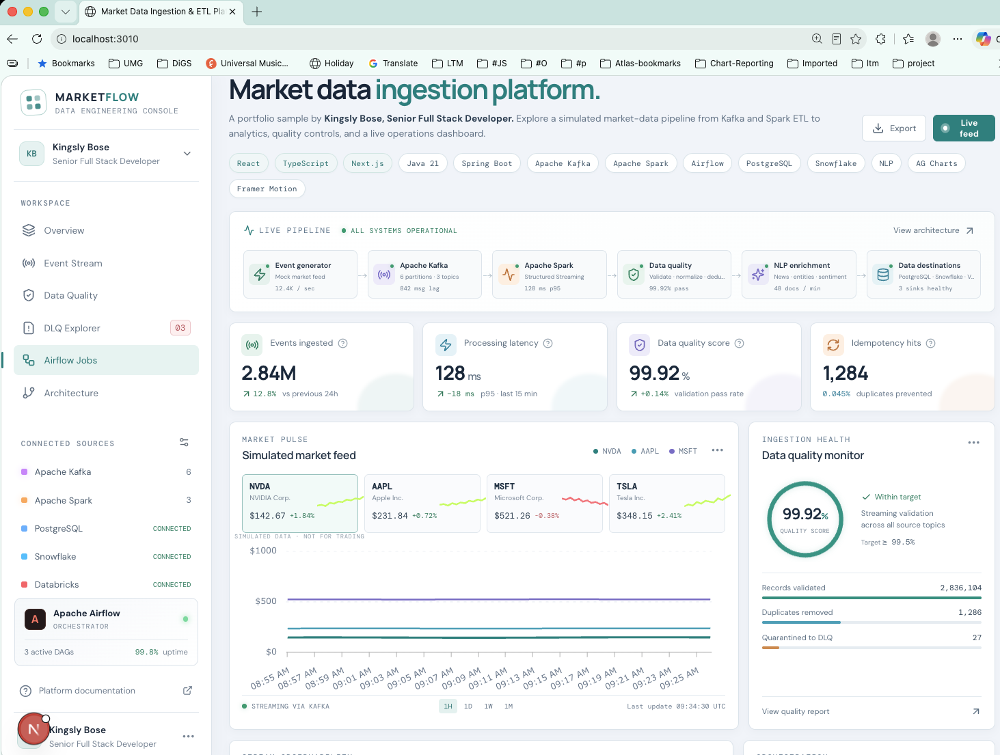
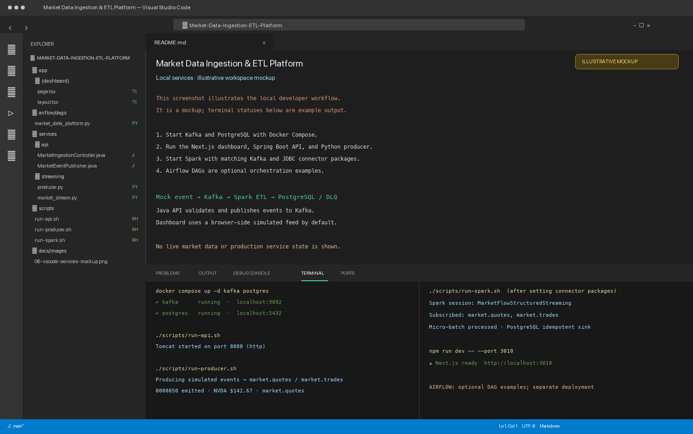
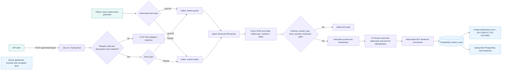
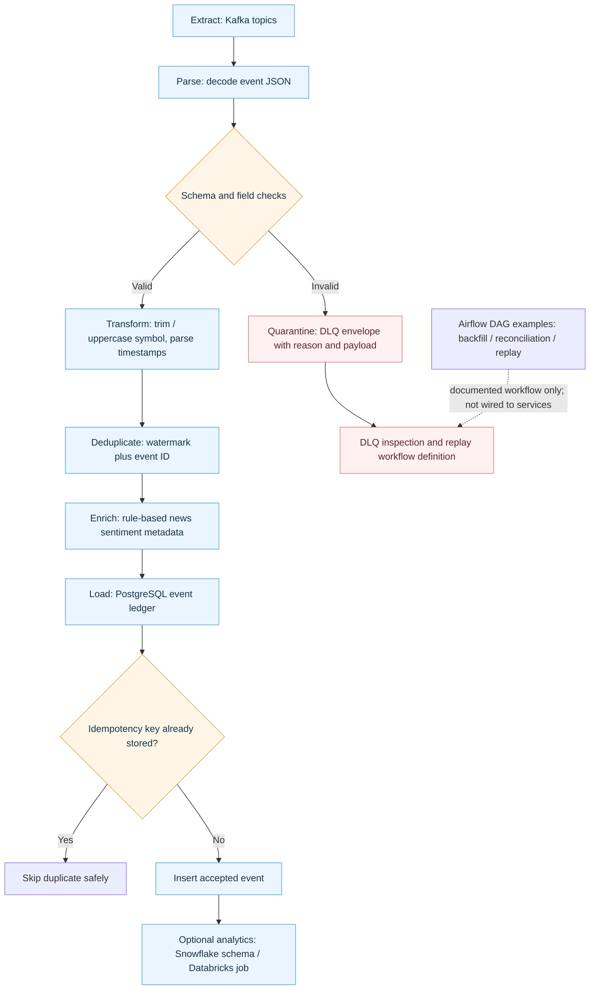
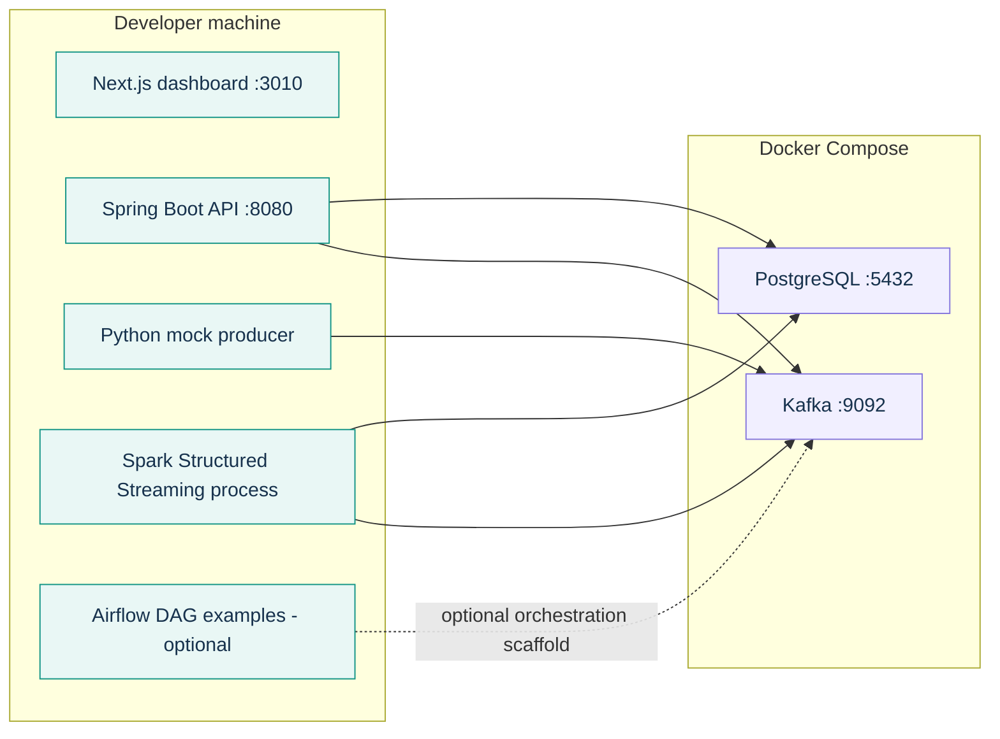
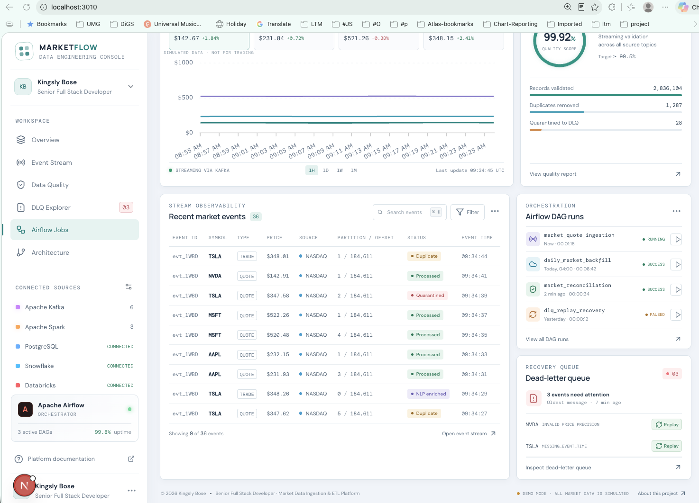
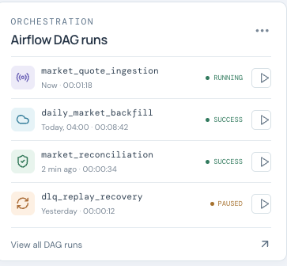
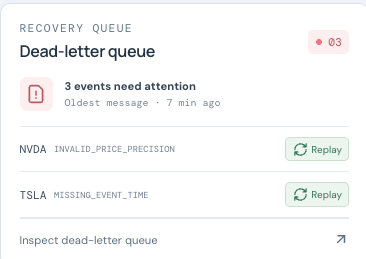
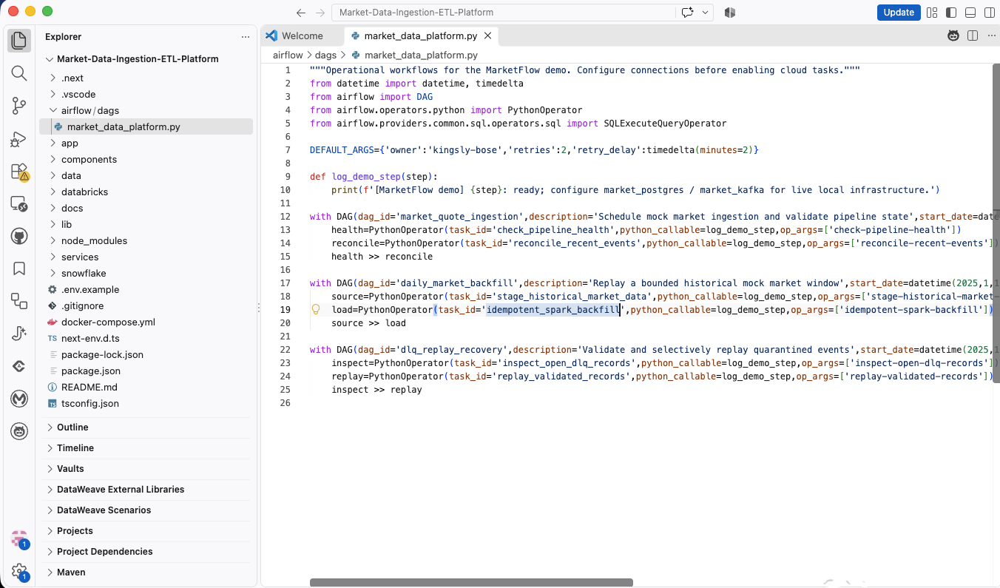

# Market Data Ingestion & ETL Platform

**A full-stack data engineering portfolio project by Kingsly Bose, Senior Full Stack Developer.**

A simulated market-data platform that demonstrates an event-driven ingestion flow, streaming ETL, data quality checks, idempotent processing, NLP enrichment, dead-letter recovery, analytics storage, and an operator dashboard.

> **Demo scope:** All displayed market data is simulated. The dashboard runs independently with browser-generated demo events. Kafka, Spark, PostgreSQL, and the sample Java API can be run locally; Snowflake, Databricks, and Airflow are optional integration examples that require separate setup. This project does not connect to a broker or provide trading advice.

## Dashboard preview



Built by **Kingsly Bose** to showcase senior full-stack development across modern UI engineering, Java services, event streaming, ETL, data quality, and cloud analytics patterns.

## Technology sequence and how it is used

```text
Mock Market Event Generator (Python)
        │ schema-versioned quote / trade events
        ├──────────────────────────────┐
        │                              │
Java 21 Spring Boot Ingestion API     │
  validate payload + idempotency key  │
        └──────────────┬───────────────┘
                       ▼
Apache Kafka — market.quotes · market.trades
        │ durable topics, partitions, offsets
        ▼
Apache Spark Structured Streaming
  parse → validate → normalize → watermark/deduplicate
  idempotency check → rule-based NLP sentiment enrichment
        ├── invalid events → Kafka Dead-Letter Queue (DLQ)
        └── accepted events → PostgreSQL event ledger
                               ├── Spring Boot 3 / Java 21 API
                               └── Snowflake analytics (optional)

Apache Airflow — orchestration control plane for scheduled backfills,
                 reconciliation, and DLQ replay examples

Next.js + React + TypeScript dashboard
  AG Charts · Framer Motion · simulated live event updates
```

| Technology | Role in this portfolio sample |
|---|---|
| **Python event tooling** | Shared event contracts, normalization/validation, deterministic idempotency keys, explainable news enrichment, the Kafka mock producer, and a JSONL audit CLI. |
| **Apache Kafka** | Carries quote/trade events in topics and keeps partition/offset metadata for traceability. |
| **Apache Spark Structured Streaming** | Parses events, validates required fields, normalizes symbols/timestamps, applies a watermark and event-ID deduplication, and enriches news text with a small rule-based sentiment demo. |
| **Idempotency + PostgreSQL** | A unique database constraint on `idempotency_key` plus `ON CONFLICT DO NOTHING` makes repeated writes safe after a replay. PostgreSQL holds the event ledger and latest operational data. |
| **DLQ** | Invalid records are wrapped with a reason and original payload and sent to a dead-letter topic for inspection/recovery. |
| **Apache Airflow** | Shows DAG structure for ingestion health checks, backfill, reconciliation, and DLQ recovery. The included tasks are workflow scaffolds; configure real service calls and connections before using them to operate infrastructure. |
| **Spring Boot 3 + Java 21** | Accepts validated market events at `POST /api/market/ingest`, verifies the shared producer/event idempotency hash, and publishes to Kafka. It also provides health, market summary, and event-list REST endpoints backed by PostgreSQL. |
| **Snowflake** | Includes an optional analytical schema for historical market events and daily summaries. It is not required to run the local demo. |
| **Databricks** | The Spark job is structured to be submitted to a compatible Databricks cluster; deployment guidance is in `databricks/README.md`. |
| **NLP / vector search** | The streaming example applies a transparent keyword sentiment heuristic. A production NLP model and vector database are extension points, not bundled services. |
| **Next.js, React, TypeScript** | Powers the responsive market-data operations UI, typed event contracts, browser mock-event generator, and feed quality summaries. |
| **Shell automation** | Reproducible scripts start/stop local services, run the UI/API/producer/Spark job, and inspect service health. |
| **AG Charts + Framer Motion** | AG Charts visualizes simulated price series; Framer Motion animates incoming feed rows and dashboard transitions. |

**Control plane vs. data plane:** Kafka transports events and Spark processes them. Airflow schedules or coordinates bounded workflows such as backfills and reconciliation; it is not in the per-event streaming path.

## Local services in VS Code

The mockup below illustrates one way to arrange the project in VS Code while running the local demo. Kafka and PostgreSQL start with Docker Compose; the dashboard, Java API, Python producer, and Spark job run in separate terminals. Airflow is shown as an optional orchestration example and is not started by the default local startup script.



The screenshot is a documentation mockup, not a capture of live processes. Follow [Run the local ingestion services](#run-the-local-ingestion-services) for actual startup commands and service requirements.

## Technical flow diagrams

### Event ingestion and streaming ETL



### ETL stages and failure handling



These diagrams describe the checked-in demo. PostgreSQL is the implemented streaming sink. Snowflake and Databricks are optional examples, and the Airflow DAGs currently document orchestration tasks rather than invoking the pipeline end to end.

### Local process layout



## Data flow

1. Mock quote/trade messages can be published directly by `services/streaming/producer.py` or submitted to `POST /api/market/ingest` on the Java 21 Spring Boot API. The API validates the request and idempotency key, then publishes to `market.quotes` or `market.trades`.
2. `services/streaming/src/main/python/market_stream.py` reads those topics through Spark Structured Streaming.
3. Spark checks the schema, event ID, idempotency key, symbol, event type, positive price, quantity, schema version, and event timestamp. It normalizes the symbol and timestamp, applies a 10-minute event-time watermark, removes duplicate event IDs, and assigns a simple sentiment label from sample text.
4. Invalid records go to the configured DLQ topic with failure context. Valid records are written to PostgreSQL. The unique idempotency key prevents a replay from inserting a second row.
5. The Spring Boot API reads the PostgreSQL event ledger and exposes summary/events/health endpoints.
6. Airflow DAG examples describe scheduled health/reconciliation, historical backfill, and DLQ recovery workflows. Wire task bodies and Airflow connections to the local services before expecting them to trigger actual work.
7. Snowflake SQL provides an optional analytical destination. Databricks can run the Spark job with compatible connector libraries and a durable checkpoint location.
8. The Next.js dashboard currently uses a browser-side simulated feed, so it remains immediately viewable without starting the backend stack. It does not yet subscribe to the API using SSE/WebSocket.

## Screenshots

### Market events and ingestion quality



### Airflow orchestration panel



### Dead-letter queue recovery panel



### Airflow workflow implementation



## Prerequisites

### For the dashboard only

- Node.js 20 or later
- npm

### For the local ingestion path

- Docker Desktop or Docker Engine with Docker Compose
- Java 21 and Maven 3.9 or later for the Spring Boot API
- Python 3.10 or later and `pip`
- Apache Spark with a Kafka connector compatible with that Spark/Scala version
- PostgreSQL and Kafka are provided by the local Compose file

### Optional integrations

- An Apache Airflow environment to load the DAGs
- A Databricks workspace/cluster to run the streaming job remotely
- A Snowflake account for the optional analytics schema/load path
- Credentials should be supplied through environment variables or a secret manager; never commit them.

## Run the dashboard

From the repository root:

```bash
./scripts/run-dashboard.sh
```

Or run `npm install` followed by `npm run dev -- --port 3010`.

Open [http://localhost:3010](http://localhost:3010). The demo UI requires no external services or credentials. All prices and streaming events shown in the dashboard are fictional.

## Run the local ingestion services

### 1. Start Kafka and PostgreSQL

```bash
./scripts/start-local.sh
docker compose ps
```

PostgreSQL is exposed on `localhost:5432` with database `marketdata` and user `marketflow`. The Compose file uses a local-only development password; override it with `POSTGRES_PASSWORD` when needed. Kafka is exposed on `localhost:9092`.

### 2. Start the Spring Boot API

In another terminal:

```bash
./scripts/run-api.sh
```

The script runs `mvn spring-boot:run` from `services/api/`.

The API listens on `http://localhost:8080`:

- `GET /api/health`
- `GET /api/market/summary`
- `GET /api/market/events?limit=50`
- `POST /api/market/ingest` — validate and publish one event to Kafka

Example event (the idempotency key must be SHA-256 of the lowercased producer, a pipe, and the event ID; this matches the Python contract):

```bash
curl -i http://localhost:8080/api/market/ingest \
  -H 'Content-Type: application/json' \\
  -d '{
    "eventId":"demo-quote-001",
    "idempotencyKey":"<sha256-of-mock-exchange-pipe-demo-quote-001>",
    "schemaVersion":1,
    "producer":"mock-exchange",
    "symbol":"NVDA",
    "eventType":"QUOTE",
    "price":142.67,
    "quantity":100,
    "currency":"USD",
    "source":"NASDAQ",
    "eventTime":"2026-10-22T18:00:00Z",
    "ingestedAt":"2026-10-22T18:00:01Z",
    "newsText":""
  }'
```

The API returns `202 Accepted` with the Kafka topic, partition, and offset after Kafka acknowledges the record. `KAFKA_BOOTSTRAP_SERVERS` defaults to `localhost:9092`; topic names and publish timeout can be set with `KAFKA_TOPIC_QUOTES`, `KAFKA_TOPIC_TRADES`, and `KAFKA_PUBLISH_TIMEOUT_SECONDS`.

The database schema is initialized by the PostgreSQL container from `data/postgres/schema.sql` on its first start.

### 3. Install the event producer dependencies and emit mock events

From the repository root:

```bash
./scripts/run-producer.sh
```

The script creates `.venv` and installs the producer dependencies on its first run. To inspect an exported JSONL event file with the Python audit tool, run:

```bash
python tools/market_event_audit.py path/to/events.jsonl --output audit-report.json
```

The producer emits simulated quote and trade data. Use `MOCK_EVENT_INTERVAL` to change the delay and `MOCK_SEED` to select its random seed.

### 4. Run the Spark streaming job

Install Apache Spark locally and use Kafka and PostgreSQL connector artifacts matching the Spark and Scala versions installed on your machine. For example, supply the matching `spark-sql-kafka-0-10` and PostgreSQL JDBC packages to `spark-submit`, then run:

```bash
SPARK_KAFKA_PACKAGE=org.apache.spark:spark-sql-kafka-0-10_<scala-version>:<spark-version> \
POSTGRES_JDBC_PACKAGE=org.postgresql:postgresql:<jdbc-version> \
./scripts/run-spark.sh
```

Set `KAFKA_BOOTSTRAP_SERVERS`, `KAFKA_TOPICS`, `PG_JDBC_URL`, `PG_HOST`, `PG_PORT`, `PG_DATABASE`, `DATABASE_USER`, and `DATABASE_PASSWORD` when they differ from the local defaults. The Python environment used by the Spark driver/executors also needs the packages in `services/streaming/requirements.txt`.

### 5. Load the Airflow examples (optional)

Mount `airflow/dags/` into an Airflow instance and configure the connections/secrets described in `docs/LOCAL_DEVELOPMENT.md`. The included DAGs document task structure and dependencies; task bodies currently log demo steps rather than launching a Spark job or replaying a Kafka record.

### 6. Use Snowflake or Databricks (optional)

See `snowflake/001_market_analytics.sql` for the analytical table example and `databricks/README.md` for Spark job deployment notes. Cloud resources and connector setup are intentionally kept outside the default local demo.

## Troubleshooting

| Symptom | What to check |
|---|---|
| Dashboard port is already in use | Choose another port: `npm run dev -- --port 3011`. |
| `npm install` fails | Confirm Node/npm versions and network access to the npm registry; remove `node_modules` and rerun `npm install` if the install was interrupted. |
| Docker services do not become healthy | Run `docker compose ps` and `docker compose logs kafka postgres`. Check Docker Desktop is running and ports 9092/5432 are free. |
| Kafka connection refused or `POST /api/market/ingest` returns 503 | Confirm the broker is healthy and the producer/Spark/API use `localhost:9092` from the host. Containers need the Compose service hostname `kafka:9092`. |
| Java ingestion returns 400 | Check required event fields and calculate `idempotencyKey` as SHA-256 of `producer.strip().lower() + "|" + eventId.strip()`; Python's `make_idempotency_key` helper uses this same contract. |
| PostgreSQL connection refused | Confirm the `postgres` container is healthy and check `PG_HOST`, `PG_PORT`, `PG_DATABASE`, `DATABASE_USER`, and `DATABASE_PASSWORD`. |
| `market_event` table is missing | The init script only runs on a fresh PostgreSQL volume. Apply `data/postgres/schema.sql` manually or, for a disposable local demo database, recreate the volume with `docker compose down -v` and start again. This removes local database data. |
| Spark cannot find Kafka source | Use a `spark-sql-kafka-0-10` artifact that matches your exact Spark and Scala versions. |
| Spark cannot load the PostgreSQL driver | Add a PostgreSQL JDBC package to `spark-submit` that matches the driver class used in the job. |
| Spark Python worker cannot import `psycopg` | Install `services/streaming/requirements.txt` in the Python environment Spark uses on the driver and workers. |
| Spark batch reprocesses after restart | This is expected with checkpoint recovery. The PostgreSQL unique key and conflict-safe insert prevent a duplicate ledger row. Keep the checkpoint directory durable for a real deployment. |
| Records appear in DLQ | Inspect `reasonCode`, `reasonDetail`, and `originalPayload`; the producer intentionally emits a negative-price sample periodically to demonstrate validation. |
| Airflow DAGs appear but do not run real backfills | The checked-in tasks are scaffolds. Configure Airflow connections and replace the logging task bodies with Spark/API/Kafka operations before enabling operational use. |
| Snowflake or Databricks is unavailable | Those destinations are optional and are not needed to view or run the browser demo. Configure account credentials and matching connector libraries separately. |

## Project structure

```text
app/                         Next.js dashboard and light-theme styles
lib/demo-data.ts             Seeded mock prices, events, DAGs, and DLQ records
lib/feed-quality.ts          Typed TypeScript feed metrics and contract checks
lib/mock-event-generator.ts  TypeScript browser-side event simulator
services/api/                Java 21 / Spring Boot Kafka ingestion and read API
services/streaming/          Python producer, contracts, NLP, audit, and Spark ETL
airflow/dags/                Airflow orchestration examples
scripts/                     Shell commands for local setup and operations
tools/                       Python JSONL event-audit command
data/postgres/               PostgreSQL tables and idempotency constraints
databricks/                  Databricks deployment notes
snowflake/                   Snowflake analytics schema example
docs/images/                 Dashboard and implementation screenshots
```

## Portfolio highlights

This project gives recruiters a concrete example of Kingsly Bose’s work across **React/TypeScript UI engineering, Java/Spring services, Kafka event ingestion, Spark ETL, data quality, replay-safe persistence, Airflow workflow design, and analytics delivery**. It emphasizes end-to-end ownership: from an event contract and failure path through persistence, operational visibility, and a polished dashboard. The repository contains real `.py`, `.ts`/`.tsx`, and `.sh` source files; the React interface is written in TypeScript/TSX and there are no standalone HTML application pages. GitHub assigns the language breakdown automatically from tracked source files, so it should reflect the committed code rather than a manual language override.

### Suggested GitHub description

> Portfolio project by Kingsly Bose, Senior Full Stack Developer: simulated market-data ingestion with Kafka, Spark Structured Streaming, Airflow orchestration, idempotency, NLP enrichment, DLQ recovery, and a Next.js dashboard.

### Suggested GitHub topics

`market-data` · `data-engineering` · `etl` · `apache-kafka` · `apache-spark` · `apache-airflow` · `java` · `spring-boot` · `nextjs` · `typescript` · `postgresql` · `snowflake` · `databricks` · `portfolio-project`

### Suggested launch post

> I built a Market Data Ingestion & ETL Platform to showcase my work across full-stack development and data engineering. The portfolio demo simulates market events and traces them through Kafka, Spark Structured Streaming, validation, deduplication, idempotent PostgreSQL writes, NLP enrichment, and dead-letter recovery. It also includes Airflow workflow examples and a responsive Next.js dashboard built with TypeScript, AG Charts, and Framer Motion.
>
> Built by Kingsly Bose, Senior Full Stack Developer. All market events and prices are simulated.
>
> #DataEngineering #ApacheKafka #ApacheSpark #ApacheAirflow #FullStackDevelopment #PortfolioProject

Before publishing, add a live demo URL when one is available, pin the repository to your GitHub profile, and include the repository link in your résumé/portfolio. The screenshots in this README are the current local demo; they do not represent a deployed cloud environment.

### Useful shell commands

```bash
./scripts/start-local.sh      # Start Kafka and PostgreSQL
./scripts/health-check.sh     # Inspect Docker, API, and Kafka status
./scripts/run-dashboard.sh    # Start the Next.js dashboard
./scripts/run-api.sh          # Start the Java API
./scripts/run-producer.sh     # Emit simulated Kafka events
./scripts/stop-local.sh       # Stop containers without deleting the DB volume
```

Run `./scripts/run-spark.sh` after setting compatible `SPARK_KAFKA_PACKAGE` and `POSTGRES_JDBC_PACKAGE` coordinates. `./scripts/stop-local.sh` preserves stored local data; `docker compose down -v` removes the local database volume.
